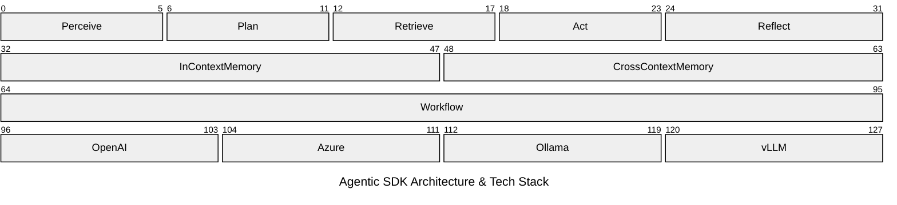
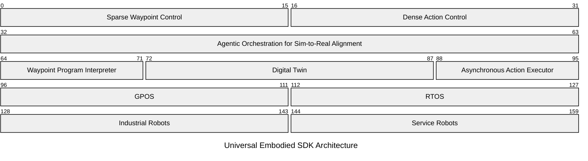
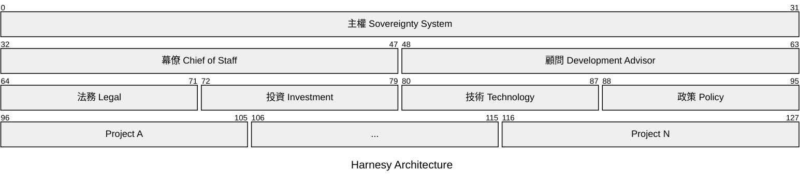

# Markov Chen

### AI R&D Architect & Developer Advocate

💡 Bridging AI research, semiconductor innovation, and robotics intelligence across **MediaTek**, **AMD**, and **NVIDIA** platforms. Helping enterprises seamlessly deploy AI solutions on **embedded systems**, **workstations**, and the **cloud**.

* [MediaTek Genio Series](https://github.com/R300-AI/MTK-genio-demo.git)
* [AMD Ryzen AI Series](https://github.com/R300-AI/amd-ryzen-ai-benchmark)
* [NVIDIA Jetson Series](https://github.com/R300-AI/NVDA-jetson-demo)

At ITRI, I act as a bridge between the developer community and product teams—translating product value to external developers and bringing their feedback back to shape **technical roadmaps**. I also build repositories and demo apps to help developers get started more easily. To see my commercial outcomes and case studies, please visit [ITRI AI Hub](ai-hub-portal.azurewebsites.net/home) website.

## Agentic SDK

To enable **AI agents** from the community to **deploy directly on diverse silicon solutions**, I proposed a [**framework**](https://github.com) that allows niche innovations to rapidly prove their concepts by leveraging public open-source techniques, significantly cutting down the overall R&D cycle.



This architecture **eliminates reinventing the wheel** to build a complete system from scratch, allowing developers to focus exclusively on innovating within any single module shown above. For instance, hardware innovators can test their chips using our ready-made upper layers, and software developers can plug in a new planning or memory mechanism without building the underlying infrastructure., as demonstrated in the implementation below.

```python
from agentic_sdk import Workflow
from agentic_sdk.audio.realtime import RealtimeTranscription
from agentic_sdk.modules import (
    NextStepWithSkills, PlanCheckReflect, SemanticRetrieve, ToolCallAction, VoiceTextPerceive,
)

endpoint = {"api_key": "ollama", "base_url": "http://localhost:11434/v1/", "model": "qwen3.8:27b"}
listener = RealtimeTranscription(api_key=..., base_url=..., model=...)

workflow = Workflow(
    perceive=VoiceTextPerceive(transport=listener),
    plan=NextStepWithSkills(skill_packages="path/to/skill-package", **endpoint),
    retrieve=SemanticRetrieve(sources=["path/to/knowledge.md"], **embedding),
    reflect=PlanCheckReflect(**endpoint),
    action=ToolCallAction(**endpoint, tools=[{
        "type": "function",
        "function": {...},
    }]),
)

result = workflow.run("What's your name?")
print(result.final_message)
```

In practice, the unified **Workflow** connects the upper `VoiceTextPerceive`, `SemanticRetrieve`, and `MemGPT` modules into a single control pipeline. This pipeline directly drives the local `Ollama` or `vLLM` endpoints, allowing the underlying silicon platform to execute these software functions as model inference.

## Universal Embodied SDK

Standford Robotics Center Roadmap - Agentic Orchestration



## Harnesy

To free humans from routine work and allow them to focus on what truly deserves their attention, I proposed Harnesy, a personal **AI Operating System** built around the philosophy of **Great Thoughts Time**. By integrating mature community-developed Skills, specialized AI Agents, and persistent project knowledge, Harnesy delegates information gathering, task execution, and cross-domain coordination to AI, allowing humans to devote their time and attention to three essential pursuits:

1. **Examine your understanding of the world by actively seeking conflicting evidence and exploring how those contradictions can be explained.**
   - Engage deeply with meaningful subjects to achieve compounding knowledge.
   - Remain open-minded and continuously update your understanding as new evidence emerges.
2. **Identify the most important problems worth solving now, with a plausible path toward progress.**
   - Where is my field heading?
   - Where do the most meaningful opportunities lie?
   - Does how I spend my time align with what I believe matters most?
   - How will this technology transform science and the institution I work in?
3. **Promote your research outcomes and turn valuable ideas into real-world impact.**
   - Practice clear and elegant writing, formal presentations, and informal conversations.
   - Learn to work within institutions and overcome excessive attachment to personal positions.
   - Periodically challenge yourself to move into new fields of research, exploring different knowledge and opportunities.

To realize this vision, Harnesy centers on the System Owner, with the Chief of Staff managing projects through **GitHub repositories** and mature Skills while integrating expertise in Legal, Investment, Technology, and Policy as projects evolve. Meanwhile, the Development Advisor uses **Claude** or **ChatGPT Output Styles** to help the user explore knowledge, refine their understanding, and strengthen communication skills through everyday interactions. Together, they connect project execution with personal growth, allowing the System Owner to devote more time to important problems while continuously improving their ability to solve them.



## About This Account

This account collects my work on software development, system design, and technical documentation — currently centered on software architecture and maintainability, workflow automation, and using clear documentation to support team collaboration. Selected projects and technical notes will be added to public repositories here over time.
